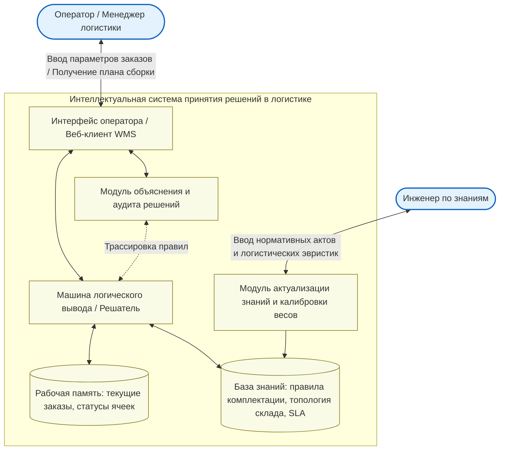

# Практическая работа № 1
## Искусственный интеллект: основные понятия и история возникновения

**Дисциплина:** Искусственный интеллект в профессиональной сфере  
**Выполнил:** студент группы ПИН-б-о-24-2, 3 курс  
**ФИО:** Целенко Александр Андреевич  
**Направление подготовки:** 09.03.03 «Прикладная информатика»  
**Профиль:** Разработка программного обеспечения и информационных систем  
**Учебное заведение:** ФГАОУ ВО «Северо-Кавказский федеральный университет»  
**Год:** 2026

---

### Цель занятия
Ознакомиться с базовыми категориями искусственного интеллекта и охарактеризовать класс задач, эффективно решаемых методами интеллектуальных систем.

### Вопросы, выносимые на обсуждение
1. Основные понятия систем искусственного интеллекта.
2. Общая характеристика задач, решаемых методами искусственного интеллекта.

---

### Задание 1. Расшифровка ключевых аббревиатур

| Аббревиатура | Полное наименование | Значение и роль в интеллектуальных системах |
|---|---|---|
| **ИИ** | Искусственный Интеллект | Междисциплинарное направление компьютерных наук, занимающееся разработкой программно-аппаратных комплексов, способных выполнять интеллектуальные функции человека: анализ ситуации, обучение, обобщение опыта и выработку решений в условиях неопределенности. |
| **ЭС** | Экспертная Система | Специализированный программный комплекс, аккумулирующий знания высококлассных экспертов в узкой прикладной области (например, логистика, аудит, медицина) и тиражирующий их для консультирования пользователей. |
| **БЗ** | База Знаний | Машинно-читаемое долговременное хранилище фактов предметной области, концептуальных связей, онтологий, эвристических правил и зависимостей, используемых машиной логического вывода. |
| **ИНС** | Искусственная Нейронная Сеть | Математическая модель, построенная по принципу сети параллельно соединенных адаптивных вычислительных элементов (искусственных нейронов), решающая задачи прогнозирования, кластеризации и аппроксимации функций через обучение на прецедентах. |
| **РП** | Рабочая Память / Решатель Проблем | Оперативная область памяти экспертной системы, в которой аккумулируются входные данные решаемой задачи, текущие факты и цепочки промежуточных гипотез. |

---

### Задание 2. Схема компонентов Интеллектуальной системы принятия решений (ИСПР)



#### Назначение элементов:
* **Пользовательский интерфейс (UI):** точка входа диспетчера складского комплекса или корпоративной ERP/WMS системы.
* **Рабочая память:** контекст текущего рабочего дня (список несобранных партий, доступность автопогрузчиков, температурный режим зон).
* **База знаний:** нормативные стандарты хранения товарных групп, правила совместимости опасных грузов, схемы маршрутизации.
* **Машина логического вывода:** логический блок, определяющий оптимальную последовательность комплектации.
* **Модуль объяснений:** формирует прозрачный отчет («Почему данный заказ отправлен через южный пандус?»).

---

### Задание 3. Процесс добычи и обработки знаний (Knowledge Engineering)

Добыча и структурирование знаний представляет собой многоэтапный инженерный процесс переноса компетенций людей-экспертов в формальную модель:

```text
[1. Сбор требований] -> [2. Извлечение] -> [3. Структурирование] -> [4. Формализация] -> [5. Верификация]
```

1. **Идентификация и очерчивание контекста:** определение круга бизнес-процессов (например, маршрутизация складских потоков), назначение ведущих экспертов (главный логист, начальник склада).
2. **Извлечение знаний (Knowledge Elicitation):**
   * *Коммуникативные методы:* анкетирование, анализ кейсов нештатных ситуаций (бой товара, задержка поставщика).
   * *Текстологические методы:* изучение технологических карт, регламентов и должностных инструкций.
   * *Интеллектуальный анализ данных (Data Mining):* извлечение скрытых ассоциативных правил из многолетних журналов складских проводок (SQL, ClickHouse).
3. **Концептуализация:** построение понятийной модели (глоссарий, классификатор номенклатурных групп, связи между зонами хранения).
4. **Формализация знаний:** представление правил в виде дерева решений, матриц продукций (`IF-THEN`) или онтологических фреймов.
5. **Тестирование и верификация:** проверка на отсутствие циклических ссылок, тупиковых правил и логических противоречий на контрольных партиях грузов.
6. **Сопровождение:** непрерывная калибровка нормативов при открытии новых распределительных центров или изменении габаритов тар.

---

### Задание 4. Задачи профессиональной сферы (09.03.03 «Прикладная информатика», складская логистика и корпоративные системы), решаемые ИИ

В рамках проектирования корпоративных информационных систем управления цепочками поставок (Supply Chain Management, WMS) методы искусственного интеллекта автоматизируют:

1. **Интеллектуальная оптимизация размещения товаров на складе (Slotting Optimization):**
   * *Проблема:* хаотичное распределение номенклатуры приводит к лишнему пробегу техники и простою комплектовщиков.
   * *Решение ИИ:* кластеризация номенклатурных позиций по частоте совместной отгрузки (ABC/XYZ-анализ с помощью нейросетей) и оптимальное назначение ячеек.
2. **Прогнозирование спроса и динамическое управление запасами (Demand Forecasting):**
   * *Проблема:* заморозка оборотных средств при избыточных закупках или упущенная прибыль при дефиците товаров.
   * *Решение ИИ:* рекуррентные нейросети (LSTM/GRU) для точного предсказания сезонного и регионального всплеска спроса на основе исторических продаж, праздников и акций.
3. **Автоматическая маршрутизация транспортных средств (Vehicle Routing Problem, VRP):**
   * *Проблема:* доставка сборных грузов десяткам розничных точек с учетом временных окон и грузоподъемности машин.
   * *Решение ИИ:* эволюционные генетические алгоритмы и методы эвристического поиска, сокращающие топливные расходы на 15–25%.
4. **Интеллектуальный аудит и распознавание накладных документов (Intelligent Document Processing):**
   * *Проблема:* ручной ввод данных из бумажных товарно-транспортных накладных (ТТН) отнимает часы и сопровождается человеческими ошибками.
   * *Решение ИИ:* сверточные нейросети и OCR-модели для извлечения таблиц и позиций номенклатуры в учетную систему 1C/SAP.

---

### Задание 5. Примеры систем искусственного интеллекта

| Пример системы ИИ | Область применения | Тип искусственного интеллекта |
|---|---|---|
| **SAP S/4HANA Smart Predict** | Корпоративное планирование цепочек поставок и бюджетирования | Предиктивная аналитическая система на ансамблях деревьев решений и регрессионных моделях |
| **CLIPS / Drools Expert** | Автоматизация регламентов бизнес-процессов и логистических правил | Продукционная символьная экспертная система на базе алгоритма Rete |
| **Amazon Kiva Coordination System** | Управление роем складских роботов-транспортировщиков | Распределенная многоагентная система с эвристическим поиском траекторий $A^*$ в реальном времени |
| **DeepAR (Amazon Web Services)** | Прогнозирование вероятностных временных рядов товарных позиций | Глубокая авторегрессионная рекуррентная нейронная сеть |
| **Fuzzy Warehouse Crane Controller** | Управление промышленными мостовыми кранами без раскачки груза | Контроллер на базе нечеткой логики (Fuzzy Logic System) |

---

### Задание 6. Сущностные отличия задач ИИ от традиционных задач на ЭВМ

| Критерий | Традиционные алгоритмы на ЭВМ | Задачи искусственного интеллекта |
|---|---|---|
| **Формализация проблемы** | Задача полностью формализована, имеется математически точная формула или детерминированный цикл перебора. | Задача слабоструктурирована; точный алгоритм либо неизвестен, либо экспоненциально неразрешим за разумное время. |
| **Характер используемых данных** | Данные строго валидированы, полны, непротиворечивы и представлены в дискретно-числовом виде. | Информация может быть зашумленной, неполной, противоречивой или выраженной качественными нечеткими терминами («высокий спрос», «близкий сектор»). |
| **Методология получения результата** | Прямое вычисление строго заданных шагов программы. | Эвристический поиск оптимума, вероятностный логический вывод или адаптивная аппроксимация весов на основе обучающей выборки. |
| **Адаптивность к новым ситуациям** | Отсутствует: при нестандартных входных значениях программа завершается ошибкой (exception) или дает некорректный результат. | Способность к обобщению (индукции): система находит наиболее правдоподобное решение даже для ранее не встречавшихся условий. |

---

### Вывод
В рамках практической работы № 1 сформировано целостное представление о структуре интеллектуальных систем принятия решений и их роли в современной прикладной информатике. Проанализированы ключевые направления применения ИИ в корпоративных системах складской логистики и документооборота, доказана необходимость перехода от жестких детерминированных алгоритмов к адаптивным экспертным и нейросетевым моделям.
