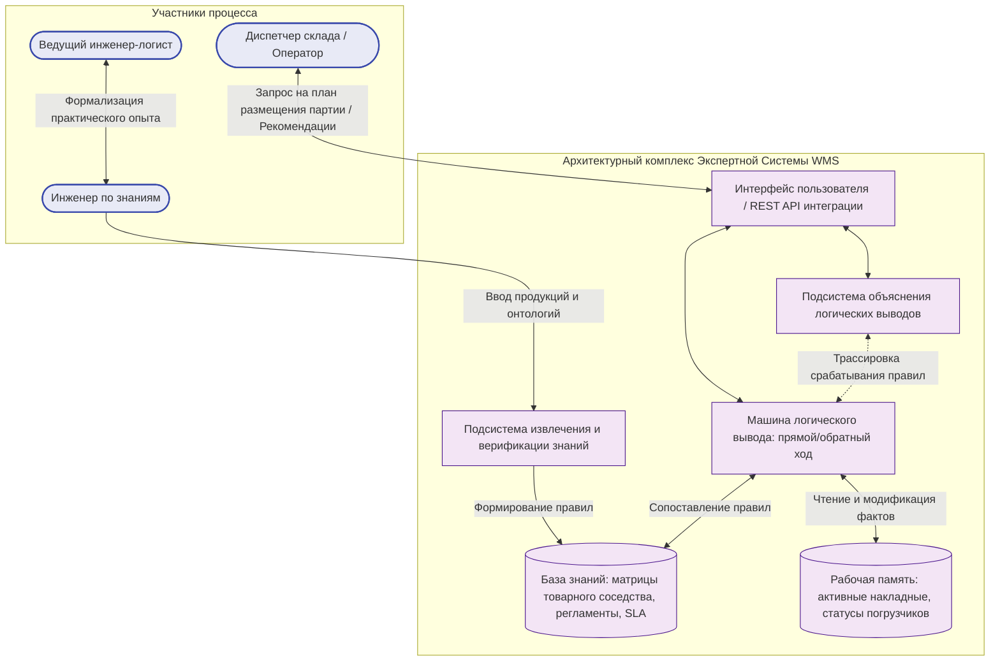

# Практическая работа № 2
## Экспертные системы

**Дисциплина:** Искусственный интеллект в профессиональной сфере  
**Выполнил:** студент группы ПИН-б-о-24-2, 3 курс  
**ФИО:** Целенко Александр Андреевич  
**Направление подготовки:** 09.03.03 «Прикладная информатика»  
**Профиль:** Разработка программного обеспечения и информационных систем  
**Учебное заведение:** ФГАОУ ВО «Северо-Кавказский федеральный университет»  
**Год:** 2026

---

### Цель занятия
Изучить структуру, жизненный цикл и методологию проектирования экспертных систем в корпоративном секторе.

### Вопросы, выносимые на обсуждение
1. Понятие экспертной системы.
2. История развития экспертных систем.
3. Структура экспертной системы.
4. Этапы разработки экспертных систем.

---

### Задание 1. Структура типичной экспертной системы



#### Назначение функциональных подсистем:
1. **База знаний (БЗ):** центральное статическое хранилище предметных правил (например: «ЕСЛИ товар относится к классу бытовой химии, ТО запрещено размещение на стеллажах с продовольствием»).
2. **Рабочая память (РП):** динамический буфер фактов текущей смены (габариты поступившего груза, температура на складе, свободные ячейки).
3. **Машина логического вывода (Inference Engine):** модуль, реализующий сопоставление текущих фактов с антецедентами правил и генерацию управляющих директив.
4. **Подсистема объяснений:** отвечает на вопросы диспетчера `«ПОЧЕМУ?»` (почему запрошен дополнительный параметр) и `«КАК?»` (на основании каких правил было принято решение назначить именно эту ячейку).
5. **Подсистема приобретения знаний:** инструментарий когнитолога для интерактивного редактирования правил без перекомпиляции ядра системы.
6. **Интерфейсный модуль:** экранные формы и REST-микросервисы интеграции с корпоративной базой данных PostgreSQL/1C.

---

### Задание 2. Специалисты, участвующие в разработке экспертной системы

Разработка промышленной экспертной системы требует слаженной работы функциональной команды:

1. **Эксперт предметной области (Domain Expert):**
   * Специалист с глубоким опытом в складской логистике и управлении цепочками поставок. Предоставляет неформализованные эвристики, типовые сценарии и методики разрешения логистических тупиков.
2. **Инженер по знаниям (Knowledge Engineer / Когнитолог):**
   * Аналитик в области инженерии знаний. Проводит глубинные интервью с экспертом, извлекает скрытые закономерности, разрабатывает понятийные онтологии и формализует знания в виде правил `IF-THEN`.
3. **Разработчик программного обеспечения / Инженер ИИ (Software Engineer):**
   * Программирует ядро системы: движок сопоставления фактов (алгоритм Rete), модули интеграции с внешними ERP/WMS базами данных и клиентский веб-интерфейс.
4. **Системный архитектор:**
   * Проектирует отказоустойчивую микросервисную топологию, сетевые шлюзы, протоколы обмена сообщениями (RabbitMQ, Kafka) и требования информационной безопасности.
5. **Конечный пользователь (End User):**
   * Кладовщики, логисты, операторы комплектации. Оценивают быстродействие, понятность интерфейса и эргономику выдаваемых советов.

---

### Задание 3. Этапы разработки экспертных систем и технология реализации

```text
1. Идентификация      --> Определение круга логистических проблем и метрик ROI
2. Концептуализация   --> Разработка словаря терминов и онтологии сущностей склада
3. Формализация       --> Выбор продукционного языка и структуры правил
4. Реализация         --> Разработка программного прототипа на Python/Java
5. Тестирование       --> Верификация выводов на 500 реальных накладных
6. Эксплуатация       --> Интеграция в контур управления складом и дообучение
```

| Этап | Содержание работ | Входная документация | Итоговый результат |
|---|---|---|---|
| **1. Идентификация** | Определение целей, бюджета, границ системы, выбор ключевых экспертов-логистов. | Анализ простоев складской техники, бизнес-требования. | ТЗ на разработку экспертной системы. |
| **2. Концептуализация** | Выделение ключевых понятий (ячейка, ярус, паллетоместо, весогабаритный класс, оборачиваемость). | Протоколы опроса экспертов, технологические регламенты. | Концептуальная модель данных и онтологический граф. |
| **3. Формализация** | Трансляция концепций в продукционные правила с учетом коэффициентов уверенности. | Концептуальная карта знаний. | Матрица формализованных продукционных правил. |
| **4. Реализация (Прототип)** | Программирование механизма вывода и веб-панели управления. | Матрица правил, схемы БД. | Рабочий прототип экспертной системы (WMS-Advisor). |
| **5. Тестирование** | Валидация логической непротиворечивости правил, выявление цикличностей и ошибок. | Тестовый пул накладных за прошлый квартал. | Акт тестирования с показателем сходимости с экспертом $> 95\%$. |
| **6. Эксплуатация** | Внедрение в рабочий процесс распределительного центра, мониторинг и добавление новых правил. | Промышленный поток заказов. | Промышленная версия системы с журналом аудита. |

---

### Задание 4. Задачи предметной области (складская логистика, ERP), решаемые экспертной системой

1. **Экспертная система назначения мест хранения крупногабаритных и опасных грузов:**
   * *Задача:* исключить размещение химически активных грузов рядом с пищевыми продуктами и соблюсти ограничения по предельной весовой нагрузке на нижние ярусы стеллажей.
2. **Интеллектуальная диспетчеризация очередей погрузочно-разгрузочных ворот (Dock Door Scheduling):**
   * *Задача:* динамическое назначение свободных пандусов прибывающим фурам с учетом срочности груза, наличия свободных рамповых тележек и температурного режима.
3. **Экспертная оценка надежности транспортных подрядчиков:**
   * *Задача:* автоматический расчет коэффициента благонадежности перевозчика на основе истории срывов сроков, повреждений упаковки и претензий клиентов.

---

### Задание 5. Примеры экспертных систем в мировой и корпоративной практике

| Экспертная система | Область применения | Тип искусственного интеллекта |
|---|---|---|
| **XCON (eXpert CONfigurer, R1)** | Историческая промышленная ЭС компании DEC для подбора оптимальной конфигурации серверов VAX | Продукционная экспертная система прямого вывода на базе Ops5 |
| **Logistics Rule Engine (WMS)** | Автоматическая раскладка товарных партий в логистических центрах | Продукционная экспертная система на алгоритме Rete |
| **American Express Authorizer's Assistant** | Финансовый сектор: одобрение лимитов по кредитным картам и выявление мошенничества | Экспертная система реального времени с нечеткими эвристиками |
| **Prospector** | Поиск полезных ископаемых по геологическим признакам | Экспертная система на вероятностных графах вывода |
| **SAP S/4HANA Rule-Based ATP** | Проверка доступности запасов и маршрутизация заказов покупателей | Корпоративная экспертная система управления цепочками поставок |

---

### Задание 6. Моделирование процесса разработки экспертной системы в группе

* **Проект:** «Экспертная система оперативного планирования размещения скоропортящихся грузов на распределительном складе (Cold-Chain WMS Advisor)».
* **Исполнитель проекта:** студент **Целенко Александр Андреевич** (выполняет сквозные роли проектной команды).

```text
[Эксперт по температурной логистике: Целенко А. А.]
   |-- Формулирует нормативы температурных зон (+2...+4 °C, -18 °C) и предельные сроки нахождения на рампе
   v
[Инженер по знаниям: Целенко А. А.]
   |-- Составляет матрицу из 18 продукционных правил классификации условий хранения
   |-- Разрабатывает структуру фактов рабочей памяти (вес, объем, класс опасности, срок годности)
   v
[Программист ИИ: Целенко А. А.]
   |-- Реализует машину логического вывода на языке Python с использованием библиотеки PyKnow/Experta
   |-- Интегрирует модуль с реляционной базой данных складского учета PostgreSQL
   v
[Инженер по качеству (QA): Целенко А. А.]
   |-- Запускает тест на 150 нестандартных товарных накладных (комбинированные сборные паллеты)
   |-- Подтверждает 100% блокировку размещения несовместимой номенклатуры в смежных ячейках.
```

---

### Вывод
В ходе практической работы № 2 освоены теоретические и прикладные аспекты создания экспертных систем. На примере логистической системы распределительного склада показано, как формализация профессиональных регламентов и неявного опыта экспертов позволяет автоматизировать критически важные процессы принятия решений, снизить риски человеческих ошибок и сократить время обработки входящих грузопотоков.
