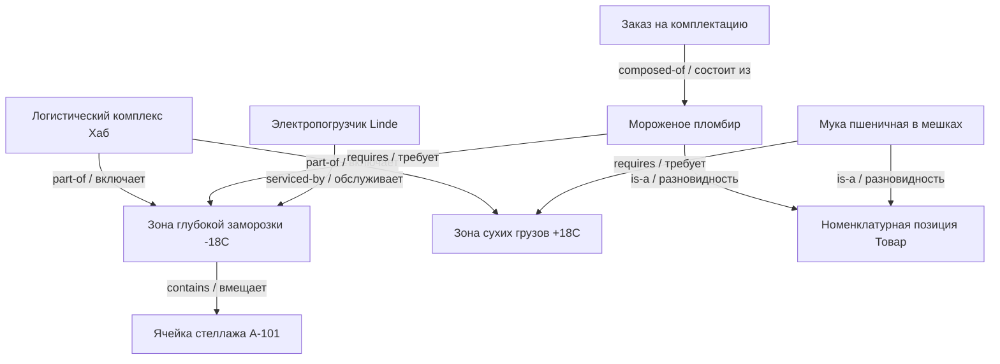
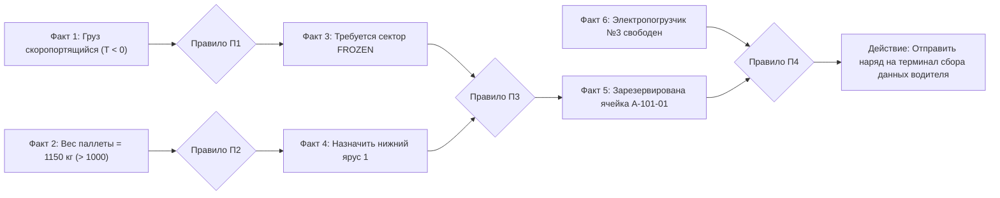

# Практическая работа № 3
## Модели представления знаний в экспертных системах

**Дисциплина:** Искусственный интеллект в профессиональной сфере  
**Выполнил:** студент группы ПИН-б-о-24-2, 3 курс  
**ФИО:** Целенко Александр Андреевич  
**Направление подготовки:** 09.03.03 «Прикладная информатика»  
**Профиль:** Разработка программного обеспечения и информационных систем  
**Учебное заведение:** ФГАОУ ВО «Северо-Кавказский федеральный университет»  
**Год:** 2026

---

### Цель занятия
Изучить основные формальные модели представления знаний в экспертных системах: семантические сети, фреймы, продукционные правила и математическую логику предикатов.

### Вопросы, выносимые на обсуждение
1. Представление знаний в экспертных системах.
2. Семантические сети.
3. Фреймовая модель.
4. Продукционная модель.
5. Логическая модель.

---

### Задание 1. Круг вопросов, решаемых при представлении знаний

При формализации предметной области для интеллектуальных корпоративных систем разработчик решает комплекс фундаментальных научно-технических задач:

1. **Семантическая полнота и выразительность:** способность языка модели адекватно описывать многообразие сущностей склада (товары, стеллажи, погрузчики, заявки), их атрибуты и пространственно-временные отношения.
2. **Вычислительная эффективность поиска вывода:** минимизация времени работы алгоритма при миллионах транзакций в базе данных; предотвращение проблемы комбинаторного взрыва при прохождении по графам понятий.
3. **Модульность и расширяемость базы знаний:** возможность оперативного добавления новых типов номенклатуры или правил погрузки без модификации исходного кода решателя.
4. **Управление неопределенностью и противоречиями:** способность корректно обрабатывать неточные измерения весогабаритных характеристик и вероятностные задержки поставщиков.
5. **Эргономичность для человека-эксперта:** доступность формата описания знаний для быстрого чтения, аудита и валидации инженерами по логистике без необходимости низкоуровневого программирования.

---

### Задание 2. Семантическая сеть из профессиональной области (складской распределительный комплекс)

Семантическая сеть представляет собой размеченный ориентированный граф, отражающий онтологию логистического хаба. Отношения: `is-a` (наследование), `part-of` (составная часть), `located-in` (пространственная локация), `serviced-by` (обслуживание), `requires` (требование к условиям).



#### Пояснение онтологических связей:
* Товар `IceCream` наследует все атрибуты класса `Product`, но накладывает жесткое ограничение `requires ZoneA`, что исключает его размещение в сухой теплой зоне `ZoneB`.
* Оборудование `Forklift` аппаратно сертифицировано для работы при отрицательных температурах и привязано к обслуживанию зоны `ZoneA`.

---

### Задание 3. Описание знаний с помощью фреймов

Фреймовая модель структурирует знания в виде взаимосвязанных блоков (фреймов-прототипов и фреймов-экземпляров) со слотами атрибутов и прикрепленными процедурами (демонами).

#### 1. Фрейм-прототип: `StorageCell` (Ячейка стеллажа)
```text
FRAME: StorageCell
    cellCode:           (тип: String, обязательный)
    tierLevel:          (тип: Integer, диапазон: 1..5)
    maxWeightCapacityKg:(тип: Float, default: 1200.0)
    currentWeightKg:    (тип: Float, default: 0.0)
    temperatureZone:    (тип: Enum [FROZEN, CHILLED, AMBIENT], default: AMBIENT)
    isOccupied:         (тип: Boolean, default: FALSE)
    storedPalletId:     (тип: String, default: NULL)
    $IF-ADDED:          RecalculateRackLoad()     ; Демон пересчета нагрузки на стойку
    $IF-NEEDED:         FindNearestReachableForklift() ; Демон поиска свободного погрузчика
```

#### 2. Фрейм-экземпляр: `Cell_A_101_01` (Ячейка нижнего яруса)
```text
FRAME-INSTANCE: Cell_A_101_01 IS-A StorageCell
    cellCode:           "WH1-A-101-01"
    tierLevel:          1
    maxWeightCapacityKg:1500.0
    currentWeightKg:    950.0
    temperatureZone:    FROZEN
    isOccupied:         TRUE
    storedPalletId:     "PL-99482-ICE"
```

#### 3. Фрейм: `DeliveryOrder` (Заказ на отгрузку)
```text
FRAME: DeliveryOrder
    orderNumber:        (тип: String)
    clientPriority:     (тип: Enum [VIP, STANDARD, ECONOMY], default: STANDARD)
    dispatchDeadline:   (тип: DateTime)
    cargoItems:         (тип: List<ProductItem>)
    totalVolumeM3:      (тип: Float)
    status:             (тип: Enum [NEW, PICKING, PACKED, SHIPPED], default: NEW)
    $IF-TIMEOUT:        EscalateOrderToSupervisor() ; Демон контроля срыва сроков
```

---

### Задание 4. Цепочка вывода продукционной модели

Продукционные правила выражаются формулой:
$$\text{ЕСЛИ } \langle \text{Условие} \rangle \longrightarrow \text{ТО } \langle \text{Заключение / Директива} \rangle$$

Рассмотрим сценарий автоматического распределения входящей паллеты при приемке на складе:

#### База продукционных правил:
* **П1:** $\text{ЕСЛИ } (\text{Груз = Скоропортящийся}) \land (\text{Температура хранения} < 0) \longrightarrow \text{Установить ФАКТ: Требуется зона FROZEN}$.
* **П2:** $\text{ЕСЛИ } (\text{Вес паллеты} > 1000\text{ кг}) \longrightarrow \text{Установить ФАКТ: Назначить ярус 1 (Напольное размещение)}$.
* **П3:** $\text{ЕСЛИ } (\text{Требуется зона FROZEN}) \land (\text{Назначить ярус 1}) \longrightarrow \text{Выбрать ячейку из пула: Свободные ячейки сектора A}$.
* **П4:** $\text{ЕСЛИ } (\text{Выбрана ячейка}) \land (\text{Погрузчик свободен}) \longrightarrow \text{Сформировать транспортное задание водителю}$.

#### Граф цепочки прямого логического вывода (Forward Chaining):


---

### Задание 5. Достоинства и недостатки моделей представления знаний

| Модель представления | Достоинства | Недостатки |
|---|---|---|
| **Семантические сети** | • Интуитивно понятная визуализация понятий предметной области.<br>• Простота организации сетевой навигации и транзитивных связей.<br>• Легкая трансляция в графовые базы данных. | • Вычислительная ресурсоемкость при выполнении поиска по сложным шаблонам.<br>• Отсутствие общепринятого стандарта семантики дуг и кванторов. |
| **Фреймовая модель** | • Строгое структурирование и поддержка наследования свойств.<br>• Возможность внедрения демонов для вычисления атрибутов по требованию.<br>• Высокая компактность описания типовых объектов. | • Вычислительная сложность разрешения множественного или противоречивого наследования.<br>• Относительно невысокая гибкость при частой смене структуры классов. |
| **Продукционная модель** | • Высокая автономность и модульность правил.<br>• Простота добавления новых бизнес-требований без риска сломать всю систему.<br>• Эффективность алгоритмов оптимизации сопоставления (Rete). | • Сложность прогнозирования поведения при разрастании базы до десятков тысяч правил.<br>• Трудность структурирования глобальных понятийных иерархий. |
| **Логическая модель (исчисление предикатов)** | • Строгий формально-математический аппарат доказательства теорем.<br>• Однозначность семантики предикатов и кванторов.<br>• Гарантия непротиворечивости вывода. | • Алгоритмическая неразрешимость логики первого порядка в общем случае.<br>• Неприспособленность к работе с нечеткими и неполными эмпирическими данными. |

---

### Задание 6. Моделирование процесса разработки подсистемы представления знаний

* **Проект:** «Разработка гибридной подсистемы представления знаний WMS-комплекса на базе фреймов и продукций».
* **Исполнитель всех ролей:** **Целенко Александр Андреевич**.

```text
[Эксперт по складской логистике: Целенко А. А.]
   |-- Составляет правила совместимости товарных групп и правила допустимых весовых нагрузок
   v
[Инженер по знаниям: Целенко А. А.]
   |-- Проектирует фреймы складских зон и 24 продукционных правила проверки ограничений
   v
[Инженер-программист: Целенко А. А.]
   |-- Разрабатывает движок сопоставления предикатов на Java/Spring Boot
   |-- Реализует структуру хранения фреймов в реляционной БД PostgreSQL с JSONB-полями
   v
[QA-инженер: Целенко А. А.]
   |-- Проводит стресс-тестирование на 10 000 параллельных накладных;
   |-- Подтверждает время логического поиска подходящей ячейки менее 15 мс.
```

---

### Вывод
В ходе практической работы № 3 исследованы основные подходы к формализации предметных знаний в интеллектуальных системах. Показано, что для практических задач прикладной информатики в сфере логистики наилучшие результаты достигаются объединением объектно-ориентированной фреймовой структуры описания топологии склада с продукционными правилами маршрутизации и валидации грузовых потоков.
