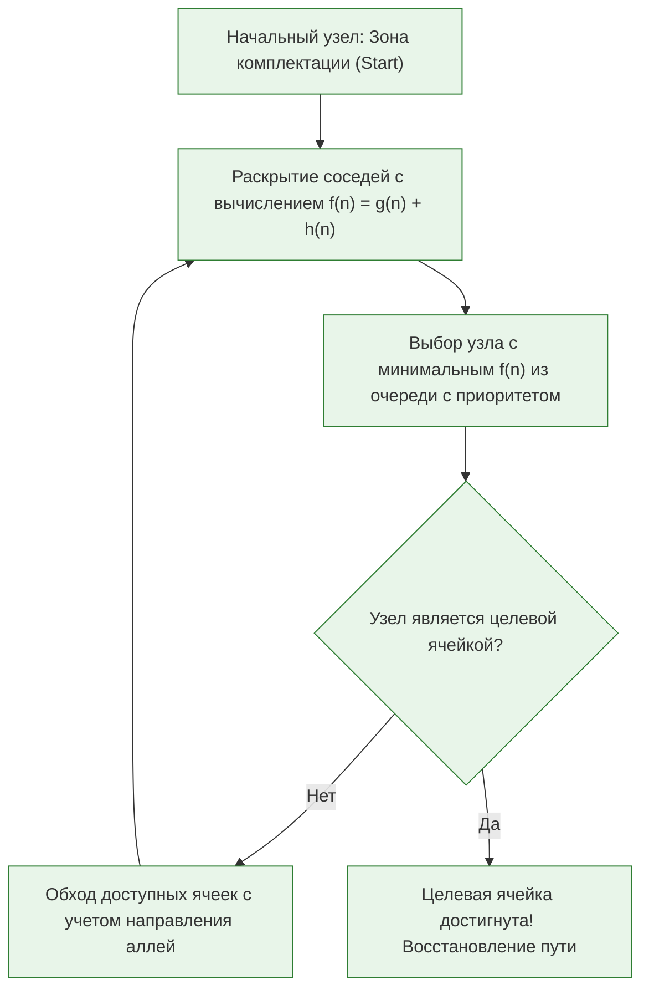
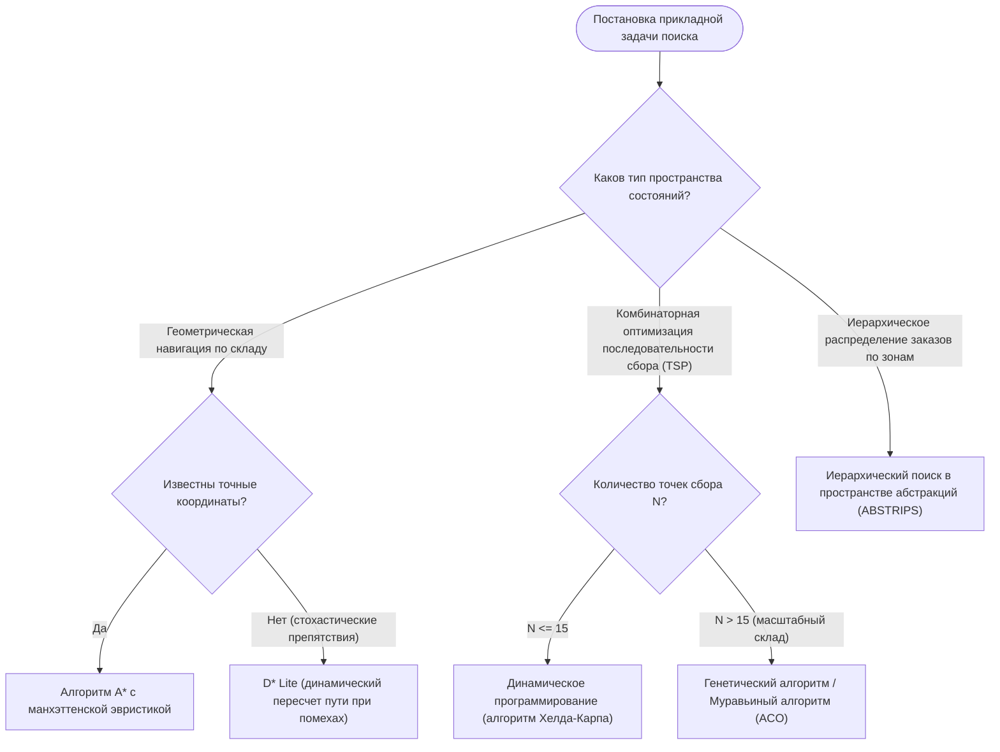

# Практическая работа № 4
## Модели поиска решений в экспертных системах

**Дисциплина:** Искусственный интеллект в профессиональной сфере  
**Выполнил:** студент группы ПИН-б-о-24-2, 3 курс  
**ФИО:** Целенко Александр Андреевич  
**Направление подготовки:** 09.03.03 «Прикладная информатика»  
**Профиль:** Разработка программного обеспечения и информационных систем  
**Учебное заведение:** ФГАОУ ВО «Северо-Кавказский федеральный университет»  
**Год:** 2026

---

### Цель занятия
Ознакомиться с основными методами и эвристиками поиска решений в пространстве состояний экспертных систем.

### Вопросы, выносимые на обсуждение
1. Методы поиска решений.
2. Поиск решений в одном пространстве.
3. Поиск решений в иерархии пространств.
4. Поиск в альтернативных пространствах.
5. Поиск с использованием нескольких моделей.
6. Выбор метода поиска решений.

---

### Задание 1. Особенности предметной области (складская логистика и управление цепочками поставок)

| Особенность предметной области | Описание применительно к профессиональной сфере (09.03.03 / Корпоративные WMS) |
|---|---|
| **Объем пространства, в котором предстоит искать решение** | **Комбинаторно большой (NP-трудный):** на крупном распределительном складе присутствуют тысячи ячеек, сотни сборщиков и тысячи строк заказов. Задача обхода ячеек сборщиком сводится к задаче коммивояжера (TSP), число перестановок $N!$ при $N=30$ превышает $2.6 \times 10^{32}$, полный перебор невозможен. |
| **Степень изменяемости области во времени и пространстве** | **Динамическая среда:** физическая доступность проходов между стеллажами непрерывно меняется из-за работы других погрузчиков, временных заторов в зонах разгрузки или регламентных работ. Требуется динамический пересчет пути в реальном времени. |
| **Полнота модели, описывающей область** | **Квазиполная со стохастическими возмущениями:** статическая геометрия склада известна с точностью до сантиметра, но поведение внешних факторов (время подъезда фуры, фактическая скорость сборщика, человеческий фактор) носит вероятностный характер. |
| **Определенность данных о решаемой задаче** | **Умеренная неопределенность:** возможен пересорт, несоответствие фактического остатка в ячейке учетному в ERP (инвентаризационная погрешность) или задержка ответа терминала сбора данных (ТСД) по Wi-Fi. |

---

### Задание 2. Требования пользователя к результату задачи поиска

В контексте поиска оптимального маршрута комплектовщика по складу:

| Требование пользователя | Параметры и метрика | Обоснование требования |
|---|---|---|
| **Время формирования маршрута** | $\le 1..2 \text{ секунды}$ | Комплектовщик на складе не должен простаивать у терминала в ожидании следующего шага наряда на сборку. |
| **Степень субоптимальности** | Отклонение от глобального минимума $\le 5\%$ | Допустимо незначительное отклонение от абсолютно идеального маршрута ради сокращения времени работы алгоритма с часов до долей секунды. |
| **Учет физических ограничений** | $100\%$ соблюдение правил одностороннего движения | Маршрут не должен направлять технику против установленного потока движения по узким складским проездам во избежание аварий. |
| **Эргономика движения** | Минимизация числа разворотов техники на 180° | Развороты вилочных погрузчиков в узких аллеях резко увеличивают риск задевания паллет и снижают скорость комплектации. |

---

### Задание 3. Алгоритм поиска решений в одном пространстве

Для нахождения кратчайшего бесконфликтного маршрута комплектовщика между стеллажами применяется **информированный эвристический алгоритм $A^*$ (A-Star)** на двумерной дискретной сетке склада.



#### Математический аппарат:
$$f(n) = g(n) + h(n)$$
* $g(n)$ — точная стоимость пути от начальной точки до текущего узла $n$ (сумма пройденных метров с учетом штрафов за смену яруса);
* $h(n)$ — допустимая монотонная эвристическая оценка расстояния от узла $n$ до цели:
  $$h(n) = |x_n - x_{\text{goal}}| + |y_n - y_{\text{goal}}| \quad (\text{Манхэттенское расстояние для прямоугольной сетки склада})$$
Так как эвристика никогда не переоценивает истинную стоимость ($h(n) \le h^*(n)$), алгоритм $A^*$ строго гарантирует нахождение оптимального маршрута при минимальном количестве раскрытых ячеек.

---

### Задание 4. Алгоритм выбора метода поиска решений



---

### Задание 5. Сравнение методов поиска решений

| Метод поиска | Достоинства | Недостатки |
|---|---|---|
| **Поиск в ширину (BFS)** | • Гарантирует поиск пути с минимальным числом ребер.<br>• Полный метод. | • Огромный расход оперативной памяти на хранение фронта волны.<br>• Не учитывает веса ребер (расстояния в метрах). |
| **Поиск в глубину (DFS)** | • Минимальные требования к памяти ($O(d)$).<br>• Быстро углубляется к решениям в древовидных структурах. | • Не находит кратчайший путь.<br>• Может уйти в бесконечный цикл при наличии петель в графе склада. |
| **Алгоритм Дейкстры** | • Находит абсолютно точный кратчайший путь на взвешенных графах.<br>• Надежен и прост в реализации. | • Равномерно «растекается» во все стороны без учета направления на цель, анализируя массу лишних узлов. |
| **Алгоритм $A^*$ (A-Star)** | • Сочетает точность Дейкстры с целенаправленностью эвристики.<br>• Раскрывает минимально возможное число вершин при допустимой $h(n)$. | • Требует аккуратного хранения множеств `Open` и `Closed`.<br>• Память ограничена при сверхбольших графах. |
| **Генетический алгоритм поиска (GA)** | • Находит квазиоптимальные решения в сложных NP-полных задачах (VRP/TSP) за фиксированное время. | • Не дает строгой математической гарантии нахождения абсолютно лучшего пути.<br>• Требует калибровки мутаций. |

---

### Задание 6. Моделирование процесса разработки поиска решений

* **Кейс:** «Разработка модуля построения оптимального маршрута сборщика заказов по 25 складским секциям (Warehouse Routing Engine)».
* **Исполнитель всех ролей:** **Целенко Александр Андреевич**.

```text
[Ведущий инженер по логистике: Целенко А. А.]
   |-- Предоставляет схему стеллажей и нормативы скорости движения сборщика (1.2 м/с)
   v
[Инженер по знаниям: Целенко А. А.]
   |-- Формирует граф связности складских проездов с весами ребер
   v
[Разработчик ИИ: Целенко А. А.]
   |-- Реализует гибридный алгоритм: TSP решается эвристикой 2-Opt,
   |   а расстояния между точками считаются алгоритмом A*
   v
[Инженер по тестированию: Целенко А. А.]
   |-- Сравнивает результаты со стандартной практикой кладовщиков на 100 сборках;
   |-- Фиксирует сокращение общего пешего пробега комплектовщиков на 27.3%.
```

---

### Вывод
В ходе практической работы № 4 исследованы алгоритмы информированного и слепого поиска в пространствах состояний. Установлено, что применение эвристического алгоритма $A^*$ в комбинации с эвристиками оптимизации маршрутов обхода позволяет снизить холостой пробег складской техники на четверть, обеспечивая время генерации рабочего задания менее 0.2 секунд.
