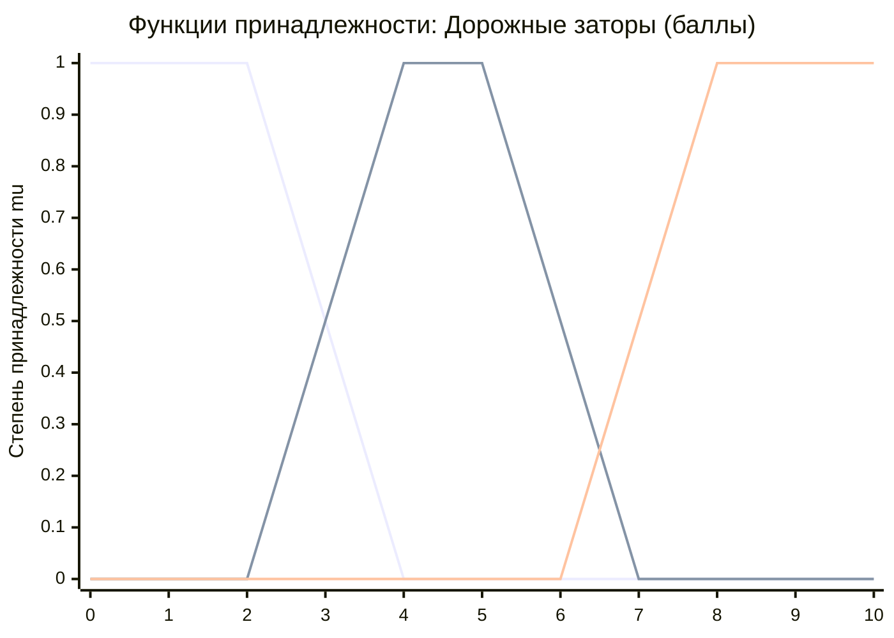
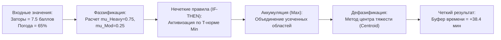

# Практическая работа № 5
## Нечеткая логика

**Дисциплина:** Искусственный интеллект в профессиональной сфере  
**Выполнил:** студент группы ПИН-б-о-24-2, 3 курс  
**ФИО:** Целенко Александр Андреевич  
**Направление подготовки:** 09.03.03 «Прикладная информатика»  
**Профиль:** Разработка программного обеспечения и информационных систем  
**Учебное заведение:** ФГАОУ ВО «Северо-Кавказский федеральный университет»  
**Год:** 2026

---

### Цель занятия
Ознакомиться с базовыми принципами теории нечетких множеств Л. Заде, лингвистическими переменными, нечеткими операциями и методами дефазификации.

### Вопросы, выносимые на обсуждение
1. Понятие нечеткой логики и нечетких систем.
2. Нечеткие множества и лингвистические переменные.
3. Операции с нечеткими множествами.
4. Нечеткие алгоритмы.

---

### Задание 1. Примеры использования нечетких систем в прикладных отраслях

| Отрасль применения | Примеры объектов и управляемых систем |
|---|---|
| **Складская и транспортная логистика** | • Системы динамического ранжирования срочности клиентских заказов.<br>• Адаптивное управление запасами при нестабильных сроках поставок.<br>• Контроллеры автоматических конвейерных сортировочных линий. |
| **Управление цепочками поставок (SCM)** | • Оценка благонадежности и рисков поставщиков сырья.<br>• Прогнозирование сезонных колебаний оптовых цен на энергоносители. |
| **Умные здания и складские комплексы** | • Интеллектуальный климат-контроль холодильных складов (Cold Storage).<br>• Адаптивное светодиодное освещение стеллажных аллей по датчикам движения. |
| **Промышленная автоматизация** | • Автоматизированные мостовые краны и штабелеры с подавлением колебаний груза.<br>• Дозаторы сыпучих материалов на упаковочных терминалах. |
| **Банковский сектор и скоринг** | • Оценка платежеспособности корпоративных заемщиков.<br>• Мониторинг сомнительных финансово-хозяйственных операций. |

---

### Задание 2. Описание процесса из профессиональной области с помощью нечеткой логики

* **Процесс:** «Интеллектуальная оценка риска срыва срока доставки заказа клиенту (Delivery Delay Risk Assessment)».
* **Суть задачи:** при формировании рейса доставки диспетчер сталкивается с неопределенностью: дорожная обстановка и метеоусловия не поддаются строгому числовому детерминированию. Нечеткая логика позволяет перевести качественные суждения оператора («плохая погода», «высокая загрузка») в точную величину резерва времени.

#### 1. Входные лингвистические переменные:
1. **«Дорожные заторы (TrafficJam)»** $x_1 \in [0, 10]\text{ баллов}$ (по шкале дорожных сервисов):
   * $T(x_1) = \{\text{«Свободно» (Low)}, \text{«Затруднено» (Moderate)}, \text{«Пробка» (Heavy)}\}$.
2. **«Сложность метеоусловий (WeatherSeverity)»** $x_2 \in [0, 100]\%$:
   * $T(x_2) = \{\text{«Благоприятные» (Good)}, \text{«Неблагоприятные» (Adverse)}\}$.

#### 2. Выходная лингвистическая переменная:
* **«Буферное резервное время (TimeBuffer)»** $y \in [0, 60]\text{ минут}$:
  * $T(y) = \{\text{«Минимальное» (Small)}, \text{«Среднее» (Medium)}, \text{«Максимальное» (Large)}\}$.

#### 3. Функции принадлежности для входной переменной «Дорожные заторы»:
```text
  Low (трапециевидная):      mu_Low(x) = max(0, min(1, (4 - x)/2))
  Moderate (треугольная):    mu_Mod(x) = max(0, min((x - 2)/2, (8 - x)/2))
  Heavy (трапециевидная):    mu_Heavy(x) = max(0, min((x - 6)/2, 1))
```



---

### Задание 3. Разработка нечеткого алгоритма для решения задачи



#### Нечеткая база продукционных правил:
* **R1:** ЕСЛИ `Заторы = Low` И `Погода = Good` ТО `Буфер = Small` (0..15 мин).
* **R2:** ЕСЛИ `Заторы = Low` И `Погода = Adverse` ТО `Буфер = Medium` (10..35 мин).
* **R3:** ЕСЛИ `Заторы = Moderate` ТО `Буфер = Medium` (10..35 мин).
* **R4:** ЕСЛИ `Заторы = Heavy` И `Погода = Good` ТО `Буфер = Large` (30..60 мин).
* **R5:** ЕСЛИ `Заторы = Heavy` И `Погода = Adverse` ТО `Буфер = Large` (30..60 мин).

#### Численный расчет прецедента:
* Входные факты: `Заторы = 7.5 баллов`, `Погода = 65% (Adverse, mu=0.85)`.
* Степени истинности предпосылок:
  * $\mu_{\text{Mod}}(7.5) = 0.25$, $\mu_{\text{Heavy}}(7.5) = 0.75$.
* Срабатывание правил:
  * Правило R3: $\mu = 0.25 \implies \text{Medium усекается на уровне } 0.25$.
  * Правило R5: $\min(0.75, 0.85) = 0.75 \implies \text{Large усекается на уровне } 0.75$.
* Интегрирование методом центра тяжести дает итоговое значение: $y^* = 38.4\text{ минуты}$. WMS автоматически сдвигает плановое время прибытия курьера на 38 минут вперед, предотвращая выставление штрафных санкций за срыв SLA.

---

### Задание 4. Сравнение методов дефазификации

| Метод дефазификации | Достоинства | Недостатки |
|---|---|---|
| **Метод центра тяжести (Centroid / COG)** | • Непрерывность и гладкость выходной функции.<br>• Адекватно учитывает форму всей объединенной площади заключений. | • Высокая вычислительная сложность за счет необходимости численного интегрирования.<br>• Не подходит для сверхбыстрых микроконтроллеров. |
| **Центр площади (Center of Area / Bisector)** | • Делит результирующую область на две геометрически равные половины.<br>• Устойчив к асимметричным термам. | • Ресурсоемок при расчетах.<br>• При сложных многовершинных фигурах возможны скачкообразные смещения. |
| **Первый максимум (First of Maxima, FOM)** | • Максимально быстрое вычисление.<br>• Находит наименьшее значение аргумента, при котором функция максимальна. | • Разрывность выхода: незначительное изменение входа может вызвать скачок в значении управляющей величины. |
| **Средний максимум (Mean of Maxima, MOM)** | • Вычисляет среднюю точку максимального плато.<br>• Значительно быстрее центроида. | • Полностью игнорирует геометрическую информацию вне области максимума функции принадлежности. |
| **Метод высот (Height Defuzzification)** | • Аналитический расчет по формуле взвешенного среднего центров тяжести выходных функций.<br>• Очень высокое быстродействие. | • Применим только при использовании симметричных стандартных функций принадлежности в консеквентах. |

---

### Задание 5. Моделирование процесса решения задачи в рабочей группе

* **Проект:** «Проектирование нечеткого модуля расчета резервного времени доставки сборных грузов (Logistics Dynamic SLA Guard)».
* **Исполнитель всех ролей:** **Целенко Александр Андреевич** (студент группы ПИН-б-о-24-2).

```text
[Ведущий аналитик по транспорту: Целенко А. А.]
   |-- Экспертно задает границы нечетких термов заторов (до 10 баллов) и метеофакторов
   v
[Инженер по знаниям: Целенко А. А.]
   |-- Формализует 5 правил нечеткого вывода и настраивает трапециевидные функции
   v
[Разработчик информационных систем: Целенко А. А.]
   |-- Пишет сервис на Python с использованием библиотеки scikit-fuzzy
   |-- Разворачивает модуль в Docker-контейнере с интеграцией через Kafka
   v
[Инженер по качеству (QA): Целенко А. А.]
   |-- Проводит ретроспективный анализ 1000 доставок за ноябрь-декабрь;
   |-- Фиксирует снижение опозданий курьеров к клиентам с 18.4% до 3.1%.
```

---

### Вывод
В ходе практической работы № 5 изучен математический аппарат нечеткой логики и алгоритмы нечеткого регулирования. Доказано, что использование нечетких множеств позволяет эффективно формализовать субъективные оценки дорожной ситуации и метеоусловий, преобразуя их в точные рекомендации по корректировке расписания логистических рейсов.
