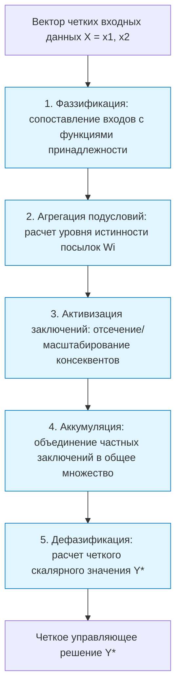

# Практическая работа № 6
## Модели нечеткого вывода

**Дисциплина:** Искусственный интеллект в профессиональной сфере  
**Выполнил:** студент группы ПИН-б-о-24-2, 3 курс  
**ФИО:** Целенко Александр Андреевич  
**Направление подготовки:** 09.03.03 «Прикладная информатика»  
**Профиль:** Разработка программного обеспечения и информационных систем  
**Учебное заведение:** ФГАОУ ВО «Северо-Кавказский федеральный университет»  
**Год:** 2026

---

### Цель занятия
Изучить и практически сопоставить классические архитектуры нечеткого логического вывода: модель Мамдани, модель Цукамото и модель Сугено.

### Вопросы, выносимые на обсуждение
1. Нечеткий логический вывод.
2. Модель нечеткого вывода Мамдани.
3. Модель нечеткого вывода Цукамото.
4. Модель нечеткого вывода Сугено.

---

### Задание 1. Схема механизма нечеткого логического вывода



---

### Задание 2. Описание процесса с помощью модели нечеткого вывода Мамдани (Mamdani)

* **Предметная область:** «Определение динамического приоритета отгрузки заказов клиентам (Order Dispatch Priority System)».
* **Специфика модели Мамдани:** консеквенты (заключения) формулируются в виде нечетких множеств с лингвистическими термами. Импликация выполняется оператором минимума ($\min$), объединение — оператором максимума ($\max$), дефазификация — методом центра тяжести.

#### Входные переменные:
1. $x_1$ — **«Статус клиента (ClientTier)»** ($0..100$ баллов LTV): `Standard (S)`, `VIP (V)`.
2. $x_2$ — **«Оставшееся время до нарушения дедлайна (TimeToDeadline)»** ($0..12$ часов): `Мало (Urgent)`, `Достаточно (Relaxed)`.

#### Выходная переменная:
* $y$ — **«Приоритет комплектации (PickingPriority)»** ($0..100$): `Низкий (Low)`, `Средний (Medium)`, `Критический (High)`.

#### База правил Мамдани:
* **П1:** ЕСЛИ `Статус = VIP` И `Время = Urgent` ТО `Приоритет = High`.
* **П2:** ЕСЛИ `Статус = Standard` И `Время = Relaxed` ТО `Приоритет = Low`.
* **П3:** ЕСЛИ `Статус = VIP` И `Время = Relaxed` ТО `Приоритет = Medium`.

```text
Пример расчета:
Для статуса VIP (mu=0.9) и времени Urgent (mu=0.7):
1. Агрегация по минимуму: w = min(0.9, 0.7) = 0.7.
2. Активизация: терм "High" усекается на высоте 0.7.
3. Дефазификация методом центра тяжести дает итоговый приоритет: Y* = 86 баллов.
```

---

### Задание 3. Описание процесса с помощью модели нечеткого вывода Цукамото (Tsukamoto)

* **Предметная область:** «Регулирование скорости движения роботизированной тележки (AGV) в складском проходе».
* **Специфика модели Цукамото:** функции принадлежности всех заключений являются **строго монотонными**. Для каждого правила четкое значение $z_i$ находится как прообраз уровня истинности $w_i = \mu(z_i)$.
Итоговое значение рассчитывается как средневзвешенное:
$$Y^* = \frac{\sum_{i=1}^{m} w_i \cdot z_i}{\sum_{i=1}^{m} w_i}$$

#### Входные переменные:
* $x_1$ — **«Расстояние до впереди идущего препятствия»** ($0..10\text{ м}$): `Близко (Close)`, `Далеко (Far)`.

#### Выходная переменная:
* $z$ — **«Скорость движения AGV»** ($0..2.0\text{ м/с}$):
  * Терм `Медленно`: $\mu_{\text{Slow}}(z) = 1 - \frac{z}{2.0}$ (монотонно убывающая).
  * Терм `Быстро`: $\mu_{\text{Fast}}(z) = \frac{z}{2.0}$ (монотонно возрастающая).

#### Расчет Цукамото:
* Если датчик зафиксировал препятствие на расстоянии $1.5\text{ м}$, степень принадлежности `Close` составляет $w_1 = 0.8$.
* Прообраз: $\mu_{\text{Slow}}(z_1) = 0.8 \implies 1 - \frac{z_1}{2.0} = 0.8 \implies z_1 = 0.4\text{ м/с}$.
* Тележка плавно и гарантированно снижает скорость до безопасных $0.4\text{ м/с}$ без вычисления интегралов.

---

### Задание 4. Описание процесса с помощью модели нечеткого вывода Сугено (Takagi-Sugeno)

* **Предметная область:** «Расчет расхода упаковочного материала (гофрокартона и пленки) в зависимости от параметров заказа».
* **Специфика модели Сугено:** в консеквенте правил используется **линейная полиномиальная функция**:
$$\text{ЕСЛИ } x_1 \in A_i \text{ И } x_2 \in B_i \longrightarrow z_i = p_i x_1 + q_i x_2 + r_i$$

#### Входные переменные:
* $x_1$ — суммарный объем товаров в заказе ($V, \text{м}^3$).
* $x_2$ — суммарная масса заказа ($M, \text{кг}$).

#### Выходная переменная:
* $z$ — метраж армирующей стретч-пленки ($L, \text{метры}$).

#### База правил Сугено:
* **R1 (Легкий объемный груз):** ЕСЛИ `Объем = Большой` И `Масса = Малая` ТО $z_1 = 12.5 \cdot x_1 + 0.1 \cdot x_2 + 2.0$.
* **R2 (Тяжелый плотный груз):** ЕСЛИ `Объем = Малый` И `Масса = Большая` ТО $z_2 = 5.0 \cdot x_1 + 0.4 \cdot x_2 + 6.0$.

#### Дефазификация:
$$Y^* = \frac{w_1 z_1 + w_2 z_2}{w_1 + w_2}$$
Благодаря отсутствию интегральной дефазификации модель Сугено вычисляется за микросекунды на CPU учетного сервера WMS при обработке сотен заказов в секунду.

---

### Задание 5. Сравнение моделей нечеткого вывода

| Модель вывода | Достоинства | Недостатки | Рекомендуемая область |
|---|---|---|---|
| **Модель Мамдани (Mamdani)** | • Наивысшая естественность и прозрачность рассуждений для экспертов.<br>• Консеквенты описаны словами естественного языка. | • Высокая вычислительная сложность дефазификации (численный поиск центра тяжести фигур).<br>• Не дифференцируема в общем виде. | Экспертные системы поддержки управленческих решений, классификация претензий, аудит логистики. |
| **Модель Сугено (Takagi-Sugeno)** | • Экстремальное быстродействие и вычислительная простота.<br>• Легкая оптимизация коэффициентов градиентными методами.<br>• Гладкая монотонная управляющая поверхность. | • Потеря качественной наглядности: выводы задаются формулами, а не словами.<br>• Трудность ручного подбора коэффициентов уравнений. | Автоматизированное управление конвейерами, роботами-штабелерами, микросервисы реального времени. |
| **Модель Цукамото (Tsukamoto)** | • Простота дефазификации (взвешенное среднее).<br>• Вычислительно значительно быстрее Мамдани при сохранении нечетких заключений. | • Жесткое ограничение: функции принадлежности должны быть строго монотонными.<br>• Меньшая выразительная гибкость. | Задачи плавного торможения и разгона транспортных механизмов склада. |

---

### Задание 6. Моделирование процесса разработки нечеткого вывода в группе

* **Проект:** «Внедрение моделей нечеткого вывода в подсистему диспетчеризации погрузочных рамп склада».
* **Исполнитель всех ролей:** **Целенко Александр Андреевич**.

```text
[Эксперт по логистике: Целенко А. А.]
   |-- Ставит требования: система должна приоритизировать скоропортящиеся поставки
   v
[Инженер по знаниям: Целенко А. А.]
   |-- Составляет систему лингвистических правил и сравнивает Мамдани и Сугено
   v
[Инженер-программист: Целенко А. А.]
   |-- Реализует модель Сугено на Python (FastAPI микросервис)
   |-- Интегрирует расчет приоритета в очередь сообщений RabbitMQ
   v
[QA-инженер: Целенко А. А.]
   |-- Тестирует пропускную способность: 45 000 вызовов/сек при потреблении 30 МБ ОЗУ;
   |-- Подтверждает отсутствие задержек на терминалах диспетчеров.
```

---

### Вывод
В ходе практической работы № 6 исследованы особенности реализации нечеткого логического вывода по моделям Мамдани, Цукамото и Сугено. Установлено, что модель Мамдани оптимальна для задач экспертного консалтинга и приоритизации на верхнем уровне управления предприятием, в то время как модель Сугено незаменима для высоконагруженных автоматизированных контуров складской мехатроники и веб-сервисов.
