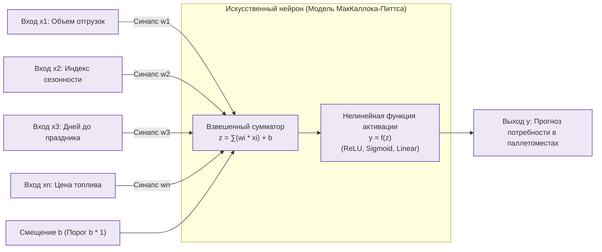

# Практическая работа № 7
## Интеллектуальные системы принятия решений, основанные на нейронных сетях

**Дисциплина:** Искусственный интеллект в профессиональной сфере  
**Выполнил:** студент группы ПИН-б-о-24-2, 3 курс  
**ФИО:** Целенко Александр Андреевич  
**Направление подготовки:** 09.03.03 «Прикладная информатика»  
**Профиль:** Разработка программного обеспечения и информационных систем  
**Учебное заведение:** ФГАОУ ВО «Северо-Кавказский федеральный университет»  
**Год:** 2026

---

### Цель занятия
Ознакомиться с базовыми концепциями искусственных нейронных сетей, математической моделью нейрона, архитектурными классами ИНС и их использованием в системах поддержки принятия решений.

### Вопросы, выносимые на обсуждение
1. Понятие нейронной сети.
2. Структура нейронной сети.
3. Классификация нейронных сетей.
4. Применение нейронных сетей.

---

### Задание 1. Схематичное представление искусственного нейрона

#### Математический формализм:
1. **Индуцированное локальное поле:**
   $$z = \sum_{i=1}^{n} w_i x_i + b$$
2. **Выходной сигнал:**
   $$y = f(z)$$
   * $\text{ReLU}(z) = \max(0, z)$ — стандартная функция для скрытых слоев глубоких персептронов;
   * $\text{Sigmoid}(z) = \frac{1}{1 + e^{-z}}$ — для логистической регрессии и бинарной классификации рисков;
   * $\text{Linear}(z) = z$ — на выходном слое регрессионных моделей прогнозирования товарооборота.

---

### Задание 2. Классификация нейронных сетей по трем ключевым признакам

| Нейронная сеть | 1. Структура сети (Топология связей) | 2. Особенности моделей нейронов | 3. Особенности обучения |
|---|---|---|---|
| **Многослойный персептрон (MLP)** | Полносвязная ациклическая сеть прямого распространения (Feedforward). Слои: входной, один или несколько скрытых, выходной. | Аналоговые дифференцируемые нейроны с непрерывными функциями активации (ReLU, GELU). | Обучение с учителем (Supervised) методом обратного распространения ошибки (Backpropagation) с градиентной оптимизацией (Adam, SGD). |
| **Рекуррентная сеть (RNN / LSTM / GRU)** | Сеть с обратными циклическими связями во времени. Наличие внутренней памяти (Cell State) для контекста прошлых шагов. | Вентильные нейроны (Gate Units: вентили забывания, входа и выхода) с сигмоидальными и тангенциальными активациями. | Обучение с учителем по алгоритму обратного распространения ошибки сквозь время (BPTT — Backpropagation Through Time). |
| **Свёрточная нейронная сеть (CNN)** | Иерархическая структура со свёрточными ядрами (Filters), локальными рецептивными полями и пулингом (Max/Average Pooling). | Нейроны с разделяемыми синаптическими весами, инвариантные к пространственному сдвигу. | Обучение с учителем на пространственных двумерных матрицах (тензорах) с градиентным спуском. |
| **Самоорганизующаяся карта Кохонена (SOM)** | Решетка (1D/2D) топологически связанных нейронов с латеральным торможением. | Нейроны со скалярным вычислением евклидова расстояния до вектора весов. Пороговый выбор победителя (Winner-Takes-All). | Обучение без учителя (Unsupervised Learning) на базе конкурентного принципа Хебба: подтягивание весов нейрона-победителя и его соседей к образцу. |

---

### Задание 3. Примеры нейронных сетей в профессиональной области (складская логистика, ERP)

| Нейронная сеть | Область применения в логистике и прикладной информатике |
|---|---|
| **LSTM / GRU Network** | Прогнозирование ежедневного объема входящих и исходящих поставок распределительного центра на 30 дней вперед с учетом праздников и трендов. |
| **Свёрточная сеть (CNN: ResNet / YOLO)** | Автоматическая оптическая дефектоскопия паллет и коробок при прохождении через сканирующую рамку разгрузочного дока (детекция замятий и повреждений). |
| **Автоэнкодер (Autoencoder)** | Детекция аномалий и ошибок инвентаризации в ERP (выявление подозрительных списаний товаров и пересортицы). |
| **Карта Кохонена (SOM)** | Сегментация контрагентов и поставщиков по степени дисциплинированности поставок и финансовой надежности. |

---

### Задание 4. Сравнение нейронных сетей для решения задачи прогнозирования спроса на товары

* **Задача:** построение среднесрочного прогноза спроса на 5000 номенклатурных позиций для формирования оптимального плана складских закупок.

| Модель нейронной сети | Достоинства | Недостатки |
|---|---|---|
| **Многослойный персептрон (MLP)** на агрегированных лаговых фичах | • Высокая скорость обучения и сверхбыстрый инференс на стандартных серверах. • Простота настройки гиперпараметров. • Легкая интеграция с реляционными базами данных. | • Требует сложной ручной генерации признаков (Feature Engineering: скользящие средние за 7, 14, 30 дней). • Не учитывает последовательную динамику временного ряда напрямую. |
| **Рекуррентная сеть LSTM / GRU** | • Естественным образом захватывает долгосрочные сезонные зависимости и тренды временных рядов без ручного создания лагов. • Высокая точность на нестационарных рядах. | • Медленный последовательный процесс обучения. • Склонность к переобучению при малом объеме исторических данных. • Требует значительных вычислительных ресурсов GPU. |
| **Трансформер временных рядов (Informer / PatchTST)** | • Параллельное обучение по всей длине последовательности через механизм внимания (Self-Attention). • Наивысшая точность прогноза на длинных горизонтах (квартал, год). | • Чрезвычайно высокая ресурсоемкость и требовательность к памяти. • Избыточен для простых рядов с низкой дисперсией. |

#### Итоговый выбор:
Для оперативного контура WMS выбрана связка: **LSTM-модель** для ключевых высокомаржинальных категорий класса А, и легковесный **MLP** для остальных позиций номенклатуры.

---

### Вывод
В ходе практической работы № 7 систематизированы принципы построения и классификации искусственных нейронных сетей. Доказано, что применение рекуррентных и полносвязных сетей в задачах прогнозирования товарооборота распределительного склада позволяет на порядок снизить дефицит товарных позиций и оптимизировать загрузку складских ячеек.
