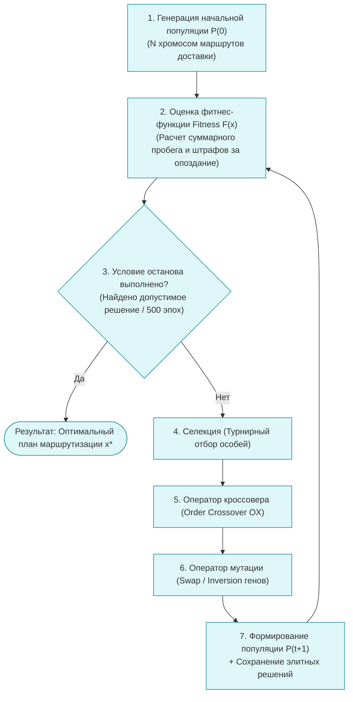

# Практическая работа № 9
## Генетические алгоритмы

**Дисциплина:** Искусственный интеллект в профессиональной сфере  
**Выполнил:** студент группы ПИН-б-о-24-2, 3 курс  
**ФИО:** Целенко Александр Андреевич  
**Направление подготовки:** 09.03.03 «Прикладная информатика»  
**Профиль:** Разработка программного обеспечения и информационных систем  
**Учебное заведение:** ФГАОУ ВО «Северо-Кавказский федеральный университет»  
**Год:** 2026

---

### Цель занятия
Изучить принципы функционирования генетических и эволюционных алгоритмов, методологию кодирования хромосом, операторы селекции, кроссовера и мутации, а также их применение в дискретной оптимизации логистических систем.

### Вопросы, выносимые на обсуждение
1. Основные понятия и принципы эволюционного моделирования.
2. Пример работы простого генетического алгоритма (SGA).
3. Достоинства и недостатки генетических алгоритмов.
4. Применение генетических алгоритмов в прикладных задачах.

---

### Задание 1. Схема работы простого генетического алгоритма



---

### Задание 2. Этапы разработки генетического алгоритма

| Этап разработки | Описание шага и проектные решения |
|---|---|
| **Шаг 1. Выбор способа кодирования хромосомы** | Преобразование предметного решения в генотип. В задаче маршрутизации транспорта (VRP) используется **перестановочное кодирование (Permutation Encoding)**: хромосома представляет собой список уникальных ID клиентов доставки `[C12, C04, C09, C01, C22]`, разделенных спецсимволом возврата в депо. |
| **Шаг 2. Разработка фитнес-функции (Fitness)** | Формализация оптимизационного критерия. В логистике минимизируется общий километраж и штрафы за нарушение временных окон клиентов:<br>$$F(x) = \frac{1}{\sum \text{Dist}(i, j) + \alpha \sum \text{Penalty}_{\text{late}} + \varepsilon}$$<br>Чем меньше суммарный пробег и опоздания, тем выше приспособленность $F(x)$. |
| **Шаг 3. Инициализация исходной популяции** | Формирование пула из $N = 100..300$ случайных перестановок точек доставки. Для ускорения сходимости часть особей засевается эвристикой ближайшего соседа (Greedy Seeding). |
| **Шаг 4. Проектирование оператора селекции** | Применяется **турнирный отбор размера $k=3$ (Tournament Selection)**: случайно выбираются три особи, и победителем становится особь с максимальным фитнесом. Этот метод менее подвержен преждевременному вырождению популяции, чем метод рулетки. |
| **Шаг 5. Операторы кроссовера и мутации** | • **Кроссовер (Order Crossover, OX, $P_c = 0.85$):** переносит непрерывный фрагмент маршрута от одного родителя, а оставшиеся точки заполняет из второго родителя с сохранением относительного порядка (исключает дублирование клиентов).<br>• **Мутация (Inversion / Swap Mutation, $P_m = 0.05$):** случайная перестановка двух точек маршрута местами. |
| **Шаг 6. Стратегия элитизма (Elitism)** | Лучшие $2\%$ особей текущей эпохи безусловно копируются в следующее поколение, что исключает случайную потерю найденного рекордного маршрута. |
| **Шаг 7. Критерий останова** | Алгоритм завершает работу, если значение фитнеса лучшей особи не улучшалось на протяжении 50 поколений (стагнация) либо исчерпан лимит времени вычислений. |

---

### Задание 3. Задачи из профессиональной области (складская логистика и транспорт), решаемые генетическим алгоритмом

1. **Многомашинная маршрутизация транспорта с временными окнами (VRPTW — Vehicle Routing Problem with Time Windows):**
   * *Задача:* построить кольцевые маршруты для автопарка из 20 фургонов для доставки заказов 150 магазинам с минимальным расходом топлива и жестким соблюдением часов приемки.
2. **Оптимизация трехмерной укладки паллет в кузов грузовика (3D Container Loading Problem):**
   * *Задача:* разместить паллеты разных габаритов и веса в ограниченном объеме фуры с учетом осевых нагрузок и очередности выгрузки на точках.
3. **Оптимальное пространственное размещение товаров на складе (Warehouse Slotting Problem):**
   * *Задача:* распределить 10 000 артикулов по стеллажам так, чтобы товары, заказываемые совместно, лежали в смежных секциях, минимизируя время сборки заказов на $30\%$.

---

### Задание 4. Достоинства и недостатки эволюционных алгоритмов

| Эволюционный алгоритм | Ключевые отличия от других подходов | Достоинства | Недостатки |
|---|---|---|---|
| **Генетические алгоритмы (Genetic Algorithms, GA)** | Оперируют преимущественно строковыми, бинарными или перестановочными структурами хромосом; доминирующую роль играет оператор скрещивания. | • Превосходно решают сложные комбинаторные задачи дискретной оптимизации (TSP, VRP, Knapsack).<br>• Не требуют аналитической дифференцируемости функции цели.<br>• Легко распараллеливаются. | • Замедление сходимости в окрестности оптимума.<br>• Требуют тонкой настройки вероятностей кроссовера и мутации.<br>• Риск преждевременной стагнации. |
| **Генетическое программирование (Genetic Programming, GP)** | Хромосомы представляют собой синтаксические деревья программных инструкций, формул или выражений переменного размера. | • Способно автоматически синтезировать аналитические формулы и исполняемые логистические алгоритмы из сырых данных. | • Высокая вычислительная сложность интерпретации деревьев.<br>• Проблема бесконтрольного разрастания кода (Bloat effect). |
| **Эволюционные стратегии (Evolutionary Strategies, ES)** | Сфокусированы на оптимизации параметров в непрерывных вещественных пространствах ($\mathbb{R}^n$); основной оператор — адаптивная гауссова мутация. | • Чрезвычайно быстрая локальная сходимость в непрерывных задачах.<br>• Самоадаптация шага мутации во время эволюции. | • Низкая применимость в дискретных комбинаторных задачах перестановки маршрутов. |
| **Дифференциальная эволюция (Differential Evolution, DE)** | Оператор мутации формируется через векторную разность между случайными индивидами популяции ($v = x_1 + F \cdot (x_2 - x_3)$). | • Исключительная надежность и скорость поиска в многомерных вещественных пространствах при минимуме гиперпараметров. | • Требует специального непрерывно-дискретного кодирования для применения в транспортных графах. |

---

### Задание 5. Моделирование процесса решения задачи в группе

* **Проект:** «Разработка генетического оптимизатора маршрутов доставки интернет-магазина (Fleet Routing Optimizer)».
* **Исполнитель всех ролей:** **Целенко Александр Андреевич** (студент группы ПИН-б-о-24-2).

```text
[Ведущий инженер по транспорту: Целенко А. А.]
   |-- Задает матрицу расстояний между 80 точками города и лимиты грузоподъемности (1.5 т)
   v
[Инженер по знаниям: Целенко А. А.]
   |-- Формализует штрафную фитнес-функцию за опоздание к клиенту (1000 руб/час)
   v
[Разработчик ИИ: Целенко А. А.]
   |-- Реализует перестановочный генетический алгоритм с оператором Order Crossover (OX) на Python
   |-- Добавляет механизм элитизма (топ-3 маршрута сохраняются)
   v
[QA-инженер: Целенко А. А.]
   |-- Проводит сравнительный бенчмарк с ручным планированием логиста:
   |-- Сокращение суммарного суточного километража на 19.4%, экономия ГСМ — 128 000 руб/мес.
```

---

### Вывод
В ходе практической работы № 9 изучена методология применения генетических и эволюционных алгоритмов для решения сложных прикладных задач дискретной оптимизации. Доказано, что для многомашинной маршрутизации и пространственной раскладки грузов генетические алгоритмы находят квазиоптимальные решения за доли секунд, обеспечивая значительный экономический эффект в управлении транспортно-логистической инфраструктурой.
